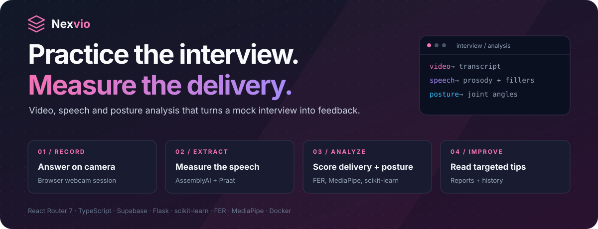
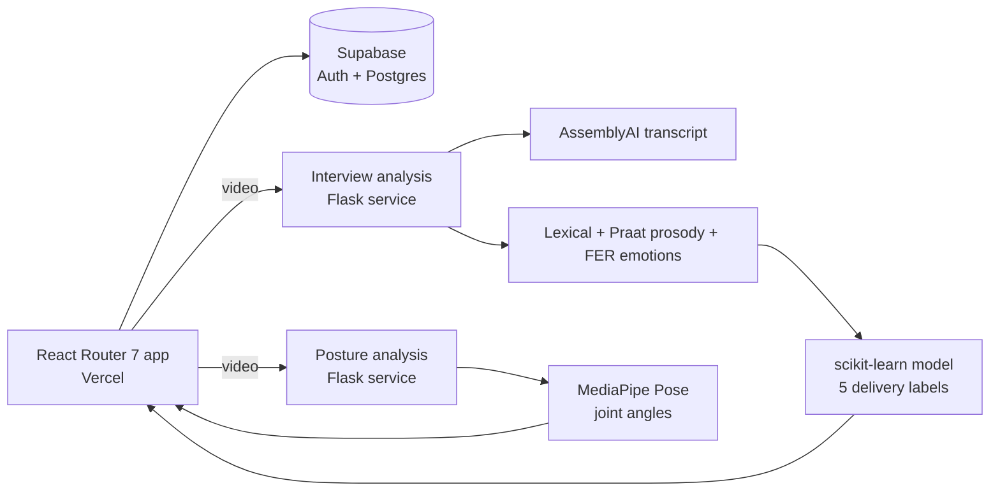

<p align="center">
  
</p>

<p align="center">
  <strong>AI interview practice with measurable feedback.</strong><br />
  Record a mock interview and get feedback on your speech, expressions and posture, not just your words.
</p>

<p align="center">
  <a href="https://nexvio-snowy.vercel.app/"></a>
</p>

<p align="center">
  
  
  
  
  
  
</p>

<p align="center">
  <a href="#the-product">Product</a> ·
  <a href="#engineering-decisions">Engineering</a> ·
  <a href="#architecture">Architecture</a> ·
  <a href="#screenshots">Screenshots</a> ·
  <a href="#run-locally">Run locally</a> ·
  <a href="#creators">Creators</a>
</p>

---

## The product

Most interview practice tools grade *what* you said. Interviewers also notice *how* you said it: pauses, filler words, energy, eye line and posture.

**Nexvio turns a recorded mock interview into concrete delivery feedback.** One service transcribes the answer and combines lexical, prosodic and facial-emotion features into five delivery labels. A second service tracks body landmarks frame by frame and explains what the joint angles say about posture. The web app wraps both in a practice workflow with reports and history.

| Capability | What you can do |
| :--- | :--- |
| **Interview analysis** | Upload or record an answer. The video is transcribed with AssemblyAI, and lexical (NLTK), prosodic (Praat-Parselmouth) and facial-emotion (FER) features feed a scikit-learn model. |
| **Delivery labels** | Get predictions for **Excited**, **Paused**, **EngagingTone**, **Calm** and **NoFillers**, each with an interpretation and improvement tips. |
| **Posture analysis** | MediaPipe Pose landmarks become shoulder, elbow and wrist angles; the interpreter flags uneven shoulders or closed-off arms with plain-language tips. |
| **Live interview room** | In-browser webcam session using `face-api.js` and MediaPipe Tasks Vision. |
| **Resume analyzer (prototype)** | A PDF/DOCX upload flow that currently shows sample ATS-style results; it is not yet connected to a model. |
| **Dashboard & reports** | History, Recharts dashboards and report pages. Parts of these views still use sample data. |
| **Accounts** | Supabase authentication with protected routes and session handling. |

### A workflow you can follow

**Record → transcribe → extract features → predict → interpret → review the report**

## Engineering decisions

| Engineering problem | Implementation | Inspect the code |
| :--- | :--- | :--- |
| Delivery is multi-modal | Transcript, prosody and facial emotions are extracted separately, merged into one feature row and scored by a single multi-output model. | [`prediction_service.py`](src/interview-analysis-service/services/prediction_service.py) |
| Video analysis is too slow for a request/response cycle | Both services accept a job, return a task ID immediately and process it on a background worker queue; the client polls `/task/<id>`. | [Interview queue](src/interview-analysis-service/task_queue.py), [posture queue](src/posture-analysis-service/task_queue.py) |
| Raw angles mean nothing to a candidate | Average joint angles are turned into inferences and tips against explicit thresholds (for example, a shoulder tilt of 16° or more). | [Posture interpreter](src/posture-analysis-service/services/result_interpreter.py), [pose detector](src/posture-analysis-service/core/pose_detector.py) |
| Audio extraction fails differently on every machine | Audio is pulled from the video with ffmpeg, falling back to MoviePy when ffmpeg is unavailable. | [`speech_to_text.py`](src/interview-analysis-service/utils/speech_to_text.py) |
| Heavy ML dependencies should not slow the web app | The React app and each ML service deploy independently (Vercel and Render), with Docker images for each. | [`docker-compose.yml`](docker-compose.yml), [service Dockerfiles](src/interview-analysis-service/Dockerfile.prod) |

The trained models and PCA transform ship in [`src/interview-analysis-service/models`](src/interview-analysis-service/models); the notebooks that produced them are in each service's `notebook/` folder.

## Architecture



<p align="center">
  
  
</p>

| Layer | Technology |
| :--- | :--- |
| Frontend | React Router 7, React, TypeScript, Vite, Tailwind CSS, Framer Motion, Recharts |
| In-browser vision | `face-api.js`, `@mediapipe/tasks-vision` |
| Auth & data | Supabase Auth and PostgreSQL ([`supabase/schema.sql`](supabase/schema.sql)) |
| Interview service | Flask, AssemblyAI, NLTK, Praat-Parselmouth, FER, OpenCV, scikit-learn |
| Posture service | Flask, MediaPipe Pose, OpenCV |
| Deployment | Vercel (web), Render (services), Docker and Docker Compose |

## Screenshots


<details>
<summary><strong>Scope and known limitations</strong></summary>

- The delivery model predicts five labels from features of a single recorded answer; it is practice feedback, not a hiring assessment.
- Interview analysis needs an AssemblyAI API key; without it, transcription and the lexical/prosodic features are unavailable.
- Both services keep their job queues in process memory, so pending jobs are lost on restart.
- Free hosting can cold start; the first analysis after a pause takes longer.
- The resume analyzer and some dashboard/report views use sample data until they are wired to real services.
- There is no automated test suite in the repository yet.

</details>

## Run locally

### Option 1: Docker Compose (whole stack)

```bash
git clone https://github.com/Lingu17/nexvio.git
cd nexvio
docker compose up --build -d
```

| Service | Port |
| :--- | :--- |
| Web app | [localhost:3000](http://localhost:3000) |
| Interview analysis | [localhost:4000](http://localhost:4000) |
| Posture analysis | [localhost:5000](http://localhost:5000) |

Interview analysis needs `ASSEMBLYAI_API_KEY`. Add it under the `interview-analysis` service's `environment:` in `docker-compose.yml` (keep the real value out of Git), and set the client's `VITE_*` service URLs to these ports.

### Option 2: Run each part

**Web app** (from `src/client`):

```bash
npm install
npm run dev
```

Create `src/client/.env` from [`.env.example`](src/client/.env.example) and point it at your services:

```env
VITE_SUPABASE_URL=
VITE_SUPABASE_PUBLISHABLE_KEY=
VITE_INTERVIEW_ANALYSIS_MICROSVC_BASE_URL=http://localhost:4000
VITE_POSTURE_ANALYSIS_MICROSVC_BASE_URL=http://localhost:5000
VITE_WEB3FORMS_ACCESS_KEY=
```

**ML services** use Conda environments (Python 3.9), defined in each service's `environment.yml`:

```bash
cd src/interview-analysis-service
conda env create -f environment.yml
conda activate interview-analysis-env
export ASSEMBLYAI_API_KEY=your_key   # PowerShell: $env:ASSEMBLYAI_API_KEY = "your_key"
python app.py                        # port 4000 (or $PORT)
```

```bash
cd src/posture-analysis-service
conda env create -f environment.yml
conda activate posture-analysis-env
python app.py                        # port 5000 (or $PORT)
```

[`script/start.sh`](script/start.sh) starts all three together on macOS/Linux, and [`script/validate-env.sh`](script/validate-env.sh) checks the required variables.

### Production deployment

- **Web app → Vercel:** set the `VITE_*` variables above, with the service URLs pointing at your deployed services.
- **Services → Render:** create one web service per folder (`src/interview-analysis-service`, `src/posture-analysis-service`) using its `Dockerfile.prod`, and set `ASSEMBLYAI_API_KEY` on the interview service.

### Service API

| Service | Routes |
| :--- | :--- |
| Interview analysis | `POST /api/v1/interview/analyze`, `GET /api/v1/interview/task/<task_id>`, `GET /api/v1/interview/tips/<label>`, `GET /api/v1/interview/health` |
| Posture analysis | `POST /api/posture/analyze`, `GET /api/posture/task/<task_id>`, `GET /api/posture/health` |

## Project map

```text
nexvio/
├── src/
│   ├── client/                          React Router 7 web app (routes, components, hooks)
│   ├── interview-analysis-service/
│   │   ├── api/routes.py                Analyze, task status, tips, health
│   │   ├── services/                    Prediction pipeline and result interpreter
│   │   ├── utils/                       Speech-to-text, Praat, lexical and emotion features
│   │   ├── models/                      Trained model and PCA files
│   │   └── notebook/                    Model training notebooks
│   └── posture-analysis-service/
│       ├── core/                        MediaPipe pose detector and video processor
│       ├── services/                    Posture analysis and interpretation
│       └── notebook/                    Posture analysis notebook
├── supabase/schema.sql                  Database schema
├── script/                              Build, start and env validation scripts
├── readme-assets/                       Architecture diagrams and logo
└── docker-compose.yml                   Full local stack
```

## Creators

**Lingraj Malipatil** · [GitHub @Lingu17](https://github.com/Lingu17) · [LinkedIn](https://www.linkedin.com/in/lingraj-malipatil-a2735a241/)

Built together with **Ujjwal Garg**, who started the project and wrote the original interview-analysis and posture-analysis microservices and their job queues.

Released under the [MIT License](LICENSE.txt).

---

<p align="center"><strong>Nexvio</strong><br />Practice the interview. Measure the delivery.</p>
